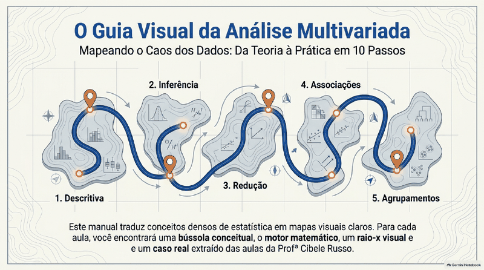
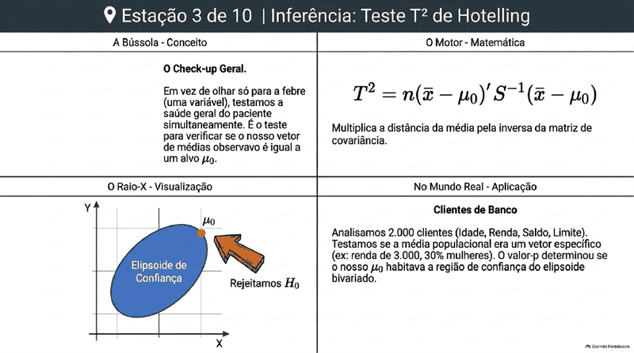
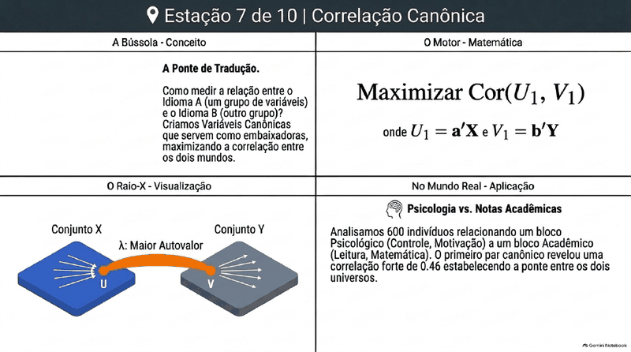
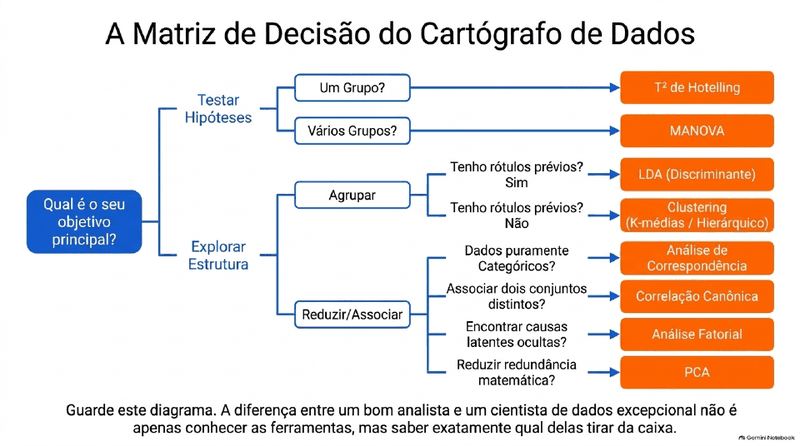

# 🧭 Análise Multivariada e Aprendizado Não-Supervisionado

   

> ✅ **Publicação autorizada pela Profa. Cibele Russo** (ICMC/USP) em 15/10/2026.

> **Todo o conteúdo original é da Profa. Dra. Cibele Russo (ICMC/USP)**, publicado no canal [@CibeleRussoUSP](https://www.youtube.com/@CibeleRussoUSP). Este material é um **derivado de estudo**, gerado com auxílio do **Google NotebookLM** a partir das aulas, e pode conter imprecisões: na dúvida, vale sempre o vídeo original.

**Sobre a trilha:** Normal multivariada, Hotelling, MANOVA, PCA, clustering, LDA.

## 🗂️ O que tem aqui

| Arquivo | Conteúdo |
|---|---|
| [📘 aulas.md](aulas.md) | Guia/trilha de aulas curtas e didáticas, com fórmulas renderizadas |
| [🎬 videos.md](videos.md) | Lista dos vídeos-fonte com links para o YouTube |
| [🖼️ slides.pdf](slides.pdf) | Apresentação de slides gerada no NotebookLM |

## 🧭 Roteiro de estudo

1. Assista (ou reveja) os vídeos da professora listados em [videos.md](videos.md).
2. Leia a aula correspondente em [aulas.md](aulas.md).
3. Revise com os slides e faça os exercícios/quiz do guia.

## 📚 Aulas da trilha

- Aula 1: Análise Descritiva Multivariada: Matrizes, Médias e Matrizes de Variância-Covariância
- Aula 2: Vetores Aleatórios, Matrizes e Propriedades das Transformações Lineares
- Aula 3: Distribuição Normal Multivariada: Densidade, Geometria e Distância de Mahalanobis
- Aula 4: Teste $`T^2`$ de Hotelling para um Vetor de Médias e Elipsoides de Confiança
- Aula 5: Comparação de Vetores de Médias: Amostras Pareadas e Independentes
- Aula 6: MANOVA: Comparação de G Grupos Multivariados e Estatística Lambda de Wilks
- Aula 7: Regressão Multivariada Clássica
- Aula 8: Análise de Correlações Canônicas (CCA)
- Aula 9: Análise de Componentes Principais (PCA) – Teoria e Decomposição Espectral
- Aula 10: Aplicação Prática de PCA e Critérios de Seleção de Componentes
- Aula 11: Clustering Hierárquico Aglomerativo: Distâncias, Métodos de Ligação e Dendrogramas
- Aula 12: Clustering Não-Hierárquico: O Algoritmo k-Médias (k-means) e Mapeamento Geográfico
- Aula 13: Análise Discriminante Linear (LDA) e Regressão Logística para Classificação
- Aula 14: Introdução à Análise de Correspondência (CA) e Síntese de Aprendizado Multivariado

## 🏷️ Subtemas 

- Análise descritiva multivariada
- Notação matricial
- Vetores aleatórios
- Distribuição normal multivariada
- Teste de Hotelling e comparação de vetores de médias
- MANOVA
- Regressão multivariada
- Componentes principais (PCA)
- Análise fatorial
- Análise de correlações canônicas
- Análise de agrupamentos (clustering)
- Análise discriminante linear (LDA)
- Discriminação logística
- Análise de correspondência
- Aula aberta (visão geral do curso)

## 🖼️ Prévia dos slides

    

[↩ Voltar ao índice principal](../../README.md)
