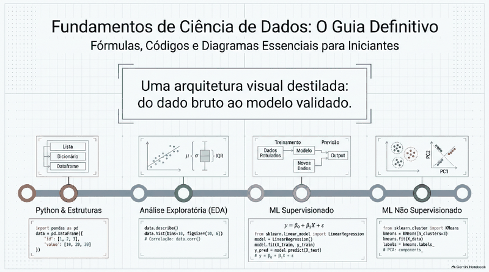
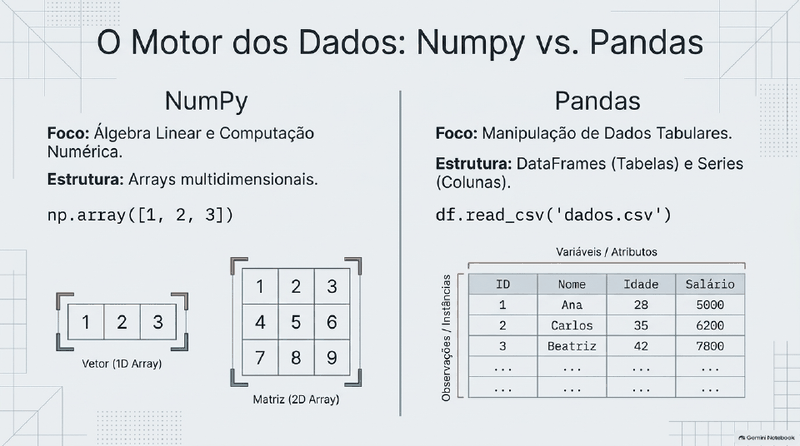
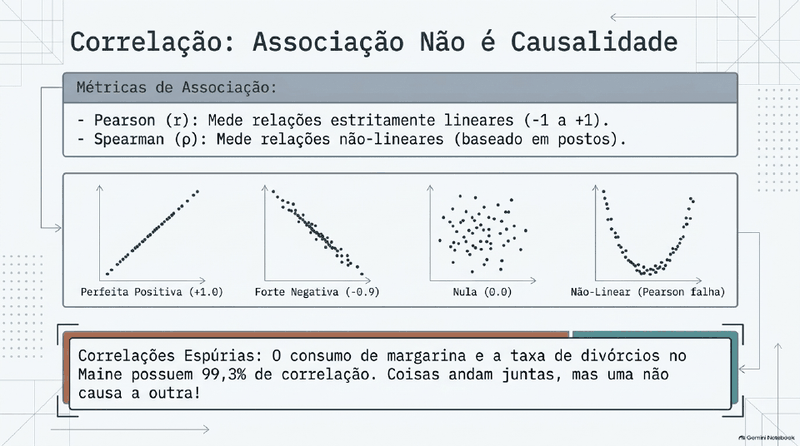
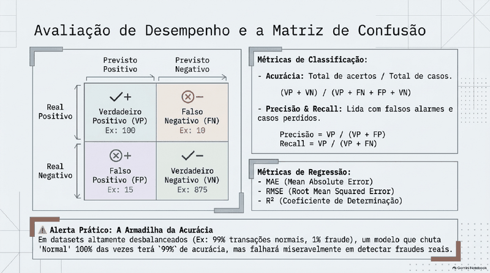

# 🐍 Fundamentos de Ciência de Dados

   

> ✅ **Publicação autorizada pela Profa. Cibele Russo** (ICMC/USP) em 15/10/2026.

> **Todo o conteúdo original é da Profa. Dra. Cibele Russo (ICMC/USP)**, publicado no canal [@CibeleRussoUSP](https://www.youtube.com/@CibeleRussoUSP). Este material é um **derivado de estudo**, gerado com auxílio do **Google NotebookLM** a partir das aulas, e pode conter imprecisões: na dúvida, vale sempre o vídeo original.

**Sobre a trilha:** Método científico, Python, NumPy/Pandas, EDA, KNN, árvores, validação.

## 🗂️ O que tem aqui

| Arquivo | Conteúdo |
|---|---|
| [📘 aulas.md](aulas.md) | Guia/trilha de aulas curtas e didáticas, com fórmulas renderizadas |
| [🎬 videos.md](videos.md) | Lista dos vídeos-fonte com links para o YouTube |
| [🖼️ slides.pdf](slides.pdf) | Apresentação de slides gerada no NotebookLM |

## 🧭 Roteiro de estudo

1. Assista (ou reveja) os vídeos da professora listados em [videos.md](videos.md).
2. Leia a aula correspondente em [aulas.md](aulas.md).
3. Revise com os slides e faça os exercícios/quiz do guia.

## 📚 Aulas da trilha

- 1. SUMÁRIO GERAL DA TRILHA
- 2. AULA 1: O Método Científico e Pensamento Científico na Ciência de Dados
- 3. AULA 2: Introdução a Data Analytics e ao Ecossistema Python
- 4. AULA 3: Fundamentos da Linguagem Python: Variáveis, Tipos e Operadores
- 5. AULA 4: Estruturas de Dados Básicas e Laços de Repetição em Python
- 6. AULA 5: Vetores, Matrizes e Operações Vetorizadas com NumPy
- 7. AULA 6: Fatiamento de Dados (Slicing) e Seleção com loc e iloc no Pandas
- 8. AULA 7: Tipos de Dados: Estruturados, Não Estruturados, Séries Temporais e Imagens
- 9. AULA 8: Estruturas e Operações com Dados em Painel
- 10. AULA 9: Séries Temporais em Painel e Associação entre Ativos
- 11. AULA 10: Análise Exploratória de Dados (EDA) e Medidas Descritivas
- 12. AULA 11: Pré-Processamento de Dados: Limpeza, Imputação e Padronização
- 13. AULA 12: Introdução ao Aprendizado de Máquina (Machine Learning)
- 14. AULA 13: O Algoritmo KNN para Classificação
- 15. AULA 14: O Algoritmo KNN para Regressão
- 16. AULA 15: Árvores de Decisão para Classificação e Regressão
- 18. AULA 17: Avaliação de Desempenho e Métricas em Modelos Supervisionados
- 19. AULA 18: Validação de Modelos, Overfitting e Validação Cruzada (K-Fold)
- ENCERRAMENTO DA TRILHA FORMATIVA

## 🏷️ Subtemas (playlists do canal)

- 5500004 Fundamentos em Ciências de Dados

## 🖼️ Prévia dos slides

    

[↩ Voltar ao índice principal](../../README.md)
