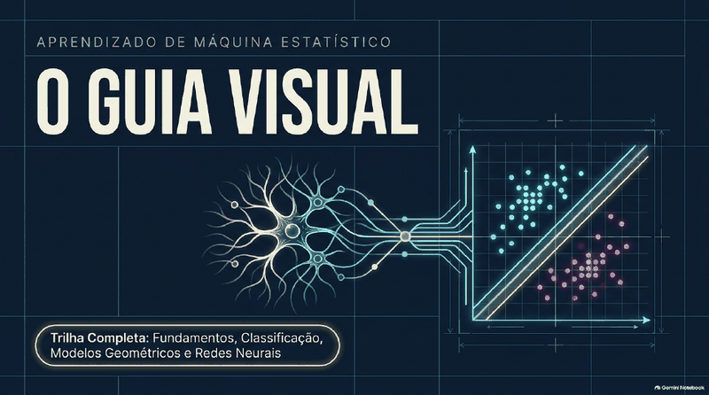
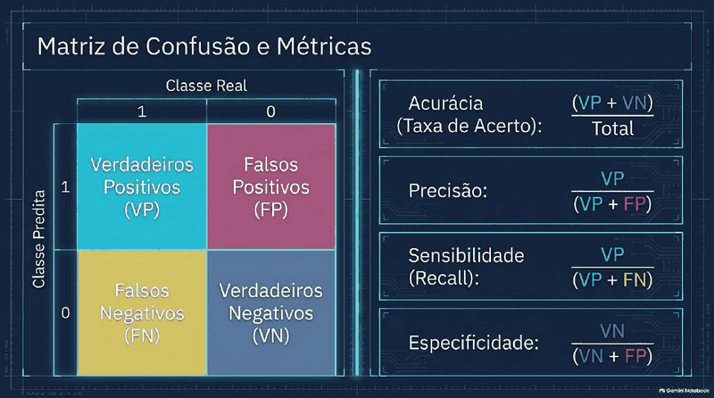
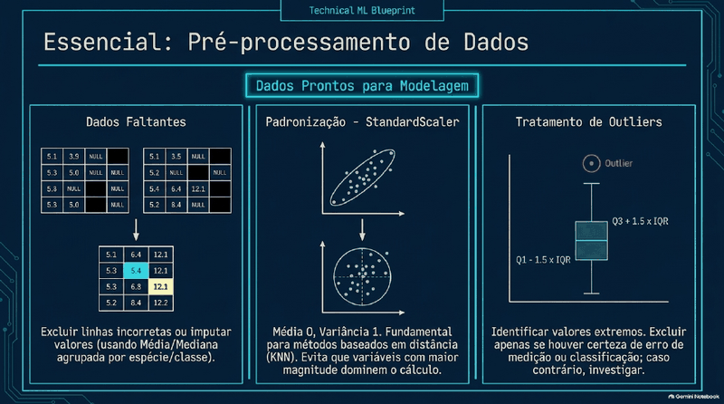
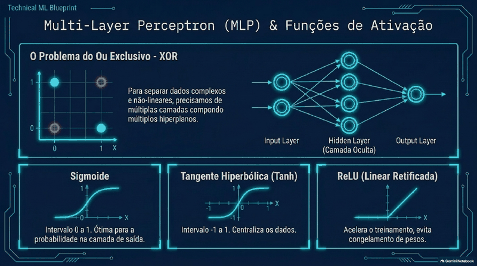

# 🤖 Machine Learning (Aprendizado de Máquina Estatístico)

   

> ✅ **Publicação autorizada pela Profa. Cibele Russo** (ICMC/USP) em 15/10/2026.

> **Todo o conteúdo original é da Profa. Dra. Cibele Russo (ICMC/USP)**, publicado no canal [@CibeleRussoUSP](https://www.youtube.com/@CibeleRussoUSP). Este material é um **derivado de estudo**, gerado com auxílio do **Google NotebookLM** a partir das aulas, e pode conter imprecisões: na dúvida, vale sempre o vídeo original.

**Sobre a trilha:** Classificação, métricas, ROC, KNN, logística, Naive Bayes, redes neurais.

## 🗂️ O que tem aqui

| Arquivo | Conteúdo |
|---|---|
| [📘 aulas.md](aulas.md) | Guia/trilha de aulas curtas e didáticas, com fórmulas renderizadas |
| [🎬 videos.md](videos.md) | Lista dos vídeos-fonte com links para o YouTube |
| [🖼️ slides.pdf](slides.pdf) | Apresentação de slides gerada no NotebookLM |

## 🧭 Roteiro de estudo

1. Assista (ou reveja) os vídeos da professora listados em [videos.md](videos.md).
2. Leia a aula correspondente em [aulas.md](aulas.md).
3. Revise com os slides e faça os exercícios/quiz do guia.

## 📚 Aulas da trilha

- Aula 1: Introdução ao Aprendizado de Máquina, Teste de Turing e Tipos de Aprendizado
- Aula 2: Pré-Processamento de Dados, Imputação e Escalonamento em Python
- Aula 3: Fundamentos da Classificação Supervisionada e Classificador de Bayes
- Aula 4: Matriz de Confusão e Métricas de Desempenho
- Aula 5: Curva ROC e Área Sob a Curva (AUC)
- Aula 6: Métodos Baseados em Distância - Algoritmo KNN
- Aula 7: Regressão Logística, Razão de Chances (Odds Ratio) e Fronteira de Decisão
- Aula 8: Probabilidade Condicional, Teorema de Bayes e Classificador Naive Bayes
- Aula 9: Introdução às Redes Neurais Artificiais e Arquitetura do Neurônio Simples
- Aula 10: O Algoritmo Perceptron e Treinamento com a Porta Lógica AND
- Aula 11: Redes Neurais Multicamadas (MLP), Funções Não Lineares e Backpropagation

## 🏷️ Subtemas 

- Introdução ao aprendizado de máquina
- Pré-processamento de dados
- Classificação e classificador de Bayes
- Matriz de confusão e métricas
- Curva ROC
- KNN
- Regressão logística e KNN (Python)
- Naive Bayes
- Introdução às redes neurais
- Perceptron
- Redes neurais multicamadas (MLP)

## 🖼️ Prévia dos slides

    

[↩ Voltar ao índice principal](../../README.md)
