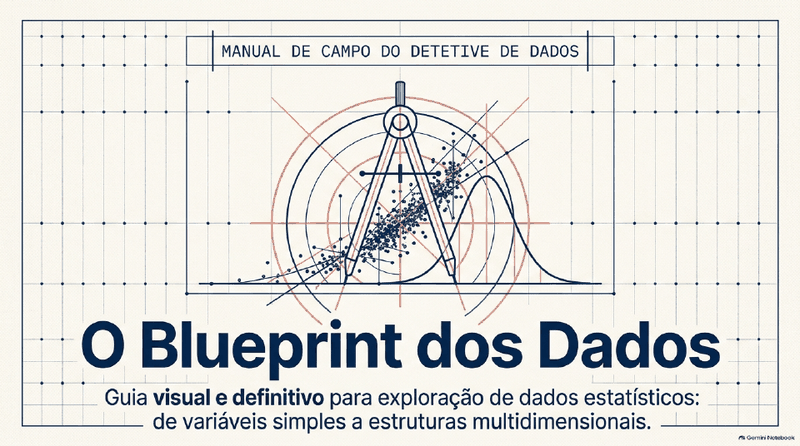
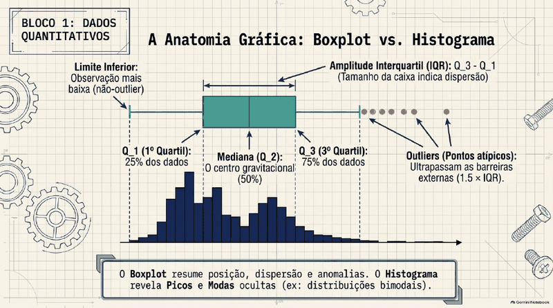
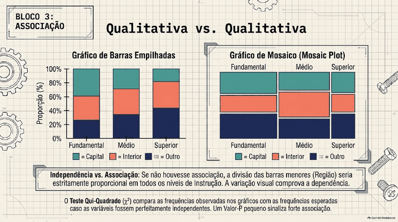
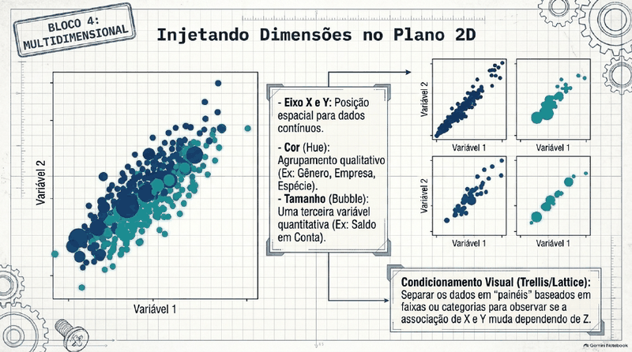

# 🎨 Visualização e Exploração de Dados

  

> **Todo o conteúdo original é da Profa. Dra. Cibele Russo (ICMC/USP)**, publicado no canal [@CibeleRussoUSP](https://www.youtube.com/@CibeleRussoUSP). Este material é um **derivado de estudo**, gerado com auxílio do **Google NotebookLM** a partir das aulas, e pode conter imprecisões: na dúvida, vale sempre o vídeo original.

**Sobre a trilha:** Gráficos em R e Python, correlação, Curva de Lorenz, EDA.

## 🗂️ O que tem aqui

| Arquivo | Conteúdo |
|---|---|
| [📘 aulas.md](aulas.md) | Guia/trilha de aulas curtas e didáticas, com fórmulas renderizadas |
| [🎬 videos.md](videos.md) | Lista dos vídeos-fonte com links para o YouTube |
| [🖼️ slides.pdf](slides.pdf) | Apresentação de slides gerada no NotebookLM |

## 🧭 Roteiro de estudo

1. Assista (ou reveja) os vídeos da professora listados em [videos.md](videos.md).
2. Leia a aula correspondente em [aulas.md](aulas.md).
3. Revise com os slides e faça os exercícios/quiz do guia.

## 🏷️ Subtemas (playlists do canal)

- (sem playlist, por título)
- SME0803 Visualização e Exploração de Dados

## 🖼️ Prévia dos slides

    

[↩ Voltar ao índice principal](../../README.md)
